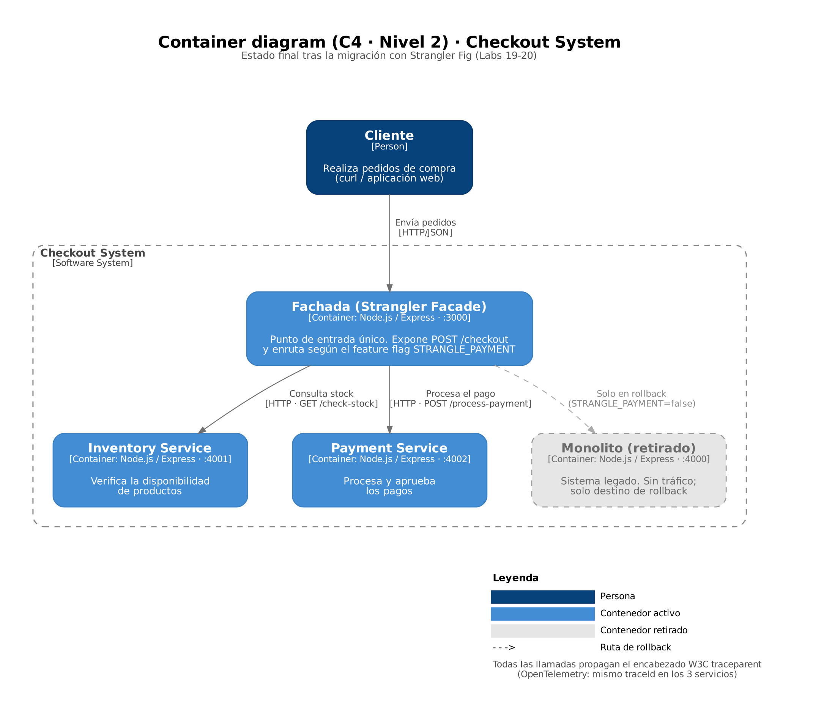
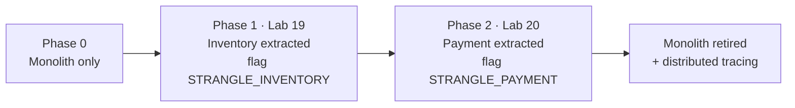

# enterprise-app-modernization

> End-to-end migration of a checkout monolith to microservices using the **Strangler Fig** pattern: a routing facade, feature-flag cutover, instant rollback and **real distributed tracing** with OpenTelemetry.


---

## Table of contents
- [Overview](#overview)
- [Architecture](#architecture)
- [Migration timeline](#migration-timeline)
- [Key features](#key-features)
- [Tech stack](#tech-stack)
- [Project structure](#project-structure)
- [Getting started](#getting-started)
- [Configuration](#configuration)
- [API reference](#api-reference)
- [Usage](#usage)
- [Observability: distributed tracing](#observability-distributed-tracing)
- [Operations: rollback runbook](#operations-rollback-runbook)
- [Design decisions](#design-decisions)
- [Production readiness](#production-readiness)
- [Documentation](#documentation)
- [Team & author](#team--author)
- [License](#license)

---

## Overview

A monolith keeps every business capability in a single deployable process. As it grows, one failing module can take the others down, scaling one function means scaling everything, and teams cannot release independently.

This project replaces a checkout monolith **incrementally**, never with a big-bang rewrite:

1. A **facade** is placed in front of the monolith as the single entry point.
2. Capabilities are extracted **one at a time** into independent services: first inventory, then payment.
3. A **feature flag** decides whether traffic goes to the legacy code or to the new service, so every step can be reverted in seconds.
4. Once every capability is extracted, the monolith receives **zero traffic** and is retired.

The final system runs as **three independent processes** behind the facade, with **OpenTelemetry** propagating the same trace across all of them.

**Migration strategy (6 Rs):** *Refactor / Re-architect*.

## Architecture

**Final state: C4 container diagram (level 2)**



| Component | Port | Responsibility |
|---|---|---|
| Facade | 3000 | Single entry point (`POST /checkout`); routes payment by `STRANGLE_PAYMENT` |
| Inventory service | 4001 | Stock check |
| Payment service | 4002 | Payment processing |
| Monolith *(retired)* | 4000 | Legacy code; no traffic, kept only as a rollback target |

## Migration timeline



| Phase | Inventory | Payment | Monolith traffic | Tag |
|---|---|---|---|---|
| 0 · Legacy | Monolith | Monolith | 100% | — |
| 1 · Inventory strangled | **Inventory service** | Monolith | Payment only | [`lab-19`](../../tree/lab-19) |
| 2 · Payment strangled | **Inventory service** | **Payment service** | **0%** | [`lab-20`](../../tree/lab-20) |

## Key features

- **Single entry point:** clients always call the facade; the `/checkout` contract never changed during the migration.
- **Feature-flag cutover:** each extraction is enabled by an environment variable, not by a code change.
- **Instant rollback:** set the flag to `false` and restart only the facade.
- **Independent services:** each service runs, scales and deploys on its own.
- **Real distributed tracing:** OpenTelemetry auto-instrumentation propagates the W3C `traceparent` header, so one request keeps the same `traceId` across three OS processes.
- **Transparent error propagation:** downstream HTTP statuses (`409`, `402`) reach the client unchanged.

## Tech stack

| Technology | Purpose |
|---|---|
| Node.js 18+ | Runtime for all services |
| Express 5 | HTTP servers |
| Axios | Service-to-service HTTP calls from the facade |
| OpenTelemetry (Node SDK + auto-instrumentations) | Distributed tracing |
| curl | Manual API testing |

## Project structure

```
enterprise-app-modernization/
├── facade/               # Strangler facade: single entry point, feature-flag routing
│   ├── app.js
│   └── tracing.js
├── inventory-service/    # Extracted in phase 1
│   ├── app.js
│   └── tracing.js
├── payment-service/      # Extracted in phase 2
│   ├── app.js
│   └── tracing.js
├── monolith/             # Legacy checkout (retired, rollback target)
│   ├── app.js
│   └── tracing.js
├── pedido.json           # Sample order for testing
├── docs/
│   ├── lab-19.md         # Phase 1 record
│   ├── lab-20.md         # Phase 2 record
│   ├── architecture.md   # Production readiness plan
│   ├── architecture/     # C4 diagram (PNG + Graphviz source)
│   └── evidence/         # Test screenshots
├── LICENSE
└── README.md
```

## Getting started

### Prerequisites
- Node.js 18 or later, npm
- curl

### Installation
```bash
git clone https://github.com/JhonnatanPenate/enterprise-app-modernization.git
cd enterprise-app-modernization

for d in monolith inventory-service payment-service facade; do (cd $d && npm install); done
```

> If you reinstall the OpenTelemetry packages from scratch and npm reports `ERESOLVE`, add `--legacy-peer-deps`. Recent versions of `auto-instrumentations-node` and `sdk-trace-node` declare conflicting peer ranges for `@opentelemetry/api`, but the 1.x API is backward compatible.

### Run
Start each service in its own terminal, from the repository root.

**Windows (cmd)**
```cmd
set "OTEL_SERVICE_NAME=monolito"   && node monolith/app.js
set "OTEL_SERVICE_NAME=inventario" && node inventory-service/app.js
set "OTEL_SERVICE_NAME=pago"       && node payment-service/app.js

set "OTEL_SERVICE_NAME=fachada"
set "STRANGLE_PAYMENT=true"
node facade/app.js
```

**Windows (PowerShell)**
```powershell
$env:OTEL_SERVICE_NAME = "fachada"
$env:STRANGLE_PAYMENT  = "true"
node facade/app.js
```

**macOS / Linux**
```bash
OTEL_SERVICE_NAME=monolito   node monolith/app.js
OTEL_SERVICE_NAME=inventario node inventory-service/app.js
OTEL_SERVICE_NAME=pago       node payment-service/app.js
OTEL_SERVICE_NAME=fachada STRANGLE_PAYMENT=true node facade/app.js
```

> In `cmd`, always quote: `set "VAR=value"`. Without quotes, a trailing space becomes part of the value and `STRANGLE_PAYMENT` silently stays `false`.

## Configuration

| Variable | Service | Default | Description |
|---|---|---|---|
| `STRANGLE_PAYMENT` | facade | `false` | `true` routes payment to the payment service |
| `PORT` | facade | `3000` | Facade port |
| `INVENTORY_SERVICE_URL` | facade | `http://localhost:4001` | Inventory service base URL |
| `PAYMENT_SERVICE_URL` | facade | `http://localhost:4002` | Payment service base URL |
| `MONOLITH_URL` | facade | `http://localhost:4000` | Monolith base URL (rollback only) |
| `OTEL_SERVICE_NAME` | all | `unknown-service` | Service name attached to every span |
| `PORT` | each service | `4000` / `4001` / `4002` | Service port |

Since phase 2, inventory is **always** served by the inventory service; the phase 1 flag `STRANGLE_INVENTORY` was retired.

## API reference

### Facade · `:3000`

`POST /checkout`
```json
{ "orderId": "FINAL1", "productId": "sku-1", "amount": 30 }
```

| Status | Body |
|---|---|
| `201` | `{ "success": true, "orderId": "FINAL1", "source": "microservicio-pago" }` |
| `409` | `{ "success": false, "reason": "sin stock", "source": "microservicio-inventario" }` |
| `402` | `{ "success": false, "reason": "pago rechazado", "source": "microservicio-pago" }` |
| `500` | `{ "success": false, "reason": "error interno de la fachada" }`, returned when a downstream service is unreachable |

### Inventory service · `:4001`

| Method | Endpoint | Response |
|---|---|---|
| `GET` | `/check-stock?productId=sku-1` | `{ "productId": "sku-1", "inStock": true, "source": "microservicio-inventario" }` |

### Payment service · `:4002`

| Method | Endpoint | Body | Response |
|---|---|---|---|
| `POST` | `/process-payment` | `orderId`, `amount` | `201` approved / `402` rejected, with `source: microservicio-pago` |

### Monolith · `:4000` *(retired)*

| Method | Endpoint | Status |
|---|---|---|
| `POST` | `/checkout` | Legacy flow, no longer called |
| `POST` | `/checkout-payment-only` | Called only when `STRANGLE_PAYMENT=false` (rollback) |

> Stock (~10% failure) and payment (~5% failure) outcomes are simulated with `Math.random()` to exercise the error paths.

## Usage

```bash
curl -X POST http://localhost:3000/checkout \
  -H "Content-Type: application/json" \
  -d @pedido.json
```

```json
{"success":true,"orderId":"FINAL1","source":"microservicio-pago"}
```

With `STRANGLE_PAYMENT=true`, the monolith log shows only its startup line, no matter how many requests are sent.

## Observability: distributed tracing

Each service loads `tracing.js` as its first line. It starts the OpenTelemetry Node SDK with HTTP and Express auto-instrumentation and exports spans to the console.

**Verifying propagation**
1. Start the four services with different `OTEL_SERVICE_NAME` values.
2. Send **one** request and wait about 10 seconds (spans are exported in batches).
3. Search for `traceId` in the facade, inventory and payment terminals.

The value is the same in all three, for example `fd3cc726eeb9364ff9400dd5ec8021f6`, even though they are separate OS processes. The instrumented monolith prints no spans, which confirms it is out of the request path.

Evidence: [facade](docs/evidence/lab-20-c-trace-fachada.png) · [inventory](docs/evidence/lab-20-c-trace-inventario.png) · [payment](docs/evidence/lab-20-c-trace-pago.png)

## Operations: rollback runbook

**Symptom:** errors or latency in the payment service after the cutover.

1. Stop the facade (`Ctrl+C`).
2. Set `STRANGLE_PAYMENT=false`.
3. Start the facade again and confirm the startup log shows `STRANGLE_PAYMENT=false`.
4. Send a test `POST /checkout`: payment is now served by the monolith (`/checkout-payment-only`).

**Why it is fast:** the monolith was never modified or removed, so nothing is rebuilt or redeployed, and clients are unaffected because the API contract is the same.

## Design decisions

| Decision | Rationale |
|---|---|
| Strangler Fig instead of a big-bang rewrite | Small, reversible steps; the system stays available throughout |
| Inventory first, payment second | Inventory is a pure function with no dependencies (lowest risk); payment is more critical and was moved once the pattern was proven |
| One feature flag per extraction | Each cutover and rollback is a configuration change, not a deployment |
| Monolith kept, not deleted | It remains a safe rollback target until the new services are proven in production |
| OpenTelemetry auto-instrumentation | Trace context propagates through HTTP without hand-written header code |
| Service URLs as environment variables | The same code runs locally, in containers or in the cloud |

## Production readiness

How this architecture would reach production using the techniques from the [Labs 1–18](https://github.com/JhonnatanPenate/cloud-devsecops-labs) (DevSecOps pipeline, Terraform modules and environments, CloudWatch alarms, containers and Helm, cost-allocation tags) is described in [`docs/architecture.md`](docs/architecture.md).

## Documentation

- [Lab 19: inventory extraction](docs/lab-19.md)
- [Lab 20: payment extraction, monolith retirement and distributed tracing](docs/lab-20.md)
- [Production readiness plan](docs/architecture.md)
- Related: [cloud-devsecops-labs](https://github.com/JhonnatanPenate/cloud-devsecops-labs), Labs 1–18

## Team & author

Built for **Cloud Development II**, ESEN (El Salvador), 2026.

**Team:** Susana Beltrán · Debbie Cruz · Andre Iraheta · Tiffany Meléndez · Dana Ochoa · Jhonnatan Peñate

**Maintainer:** Jhonnatan Peñate Serrano · [GitHub](https://github.com/JhonnatanPenate) · [LinkedIn](https://www.linkedin.com/in/jhonnatan-penate)

## License

Distributed under the MIT License. See [`LICENSE`](LICENSE).
