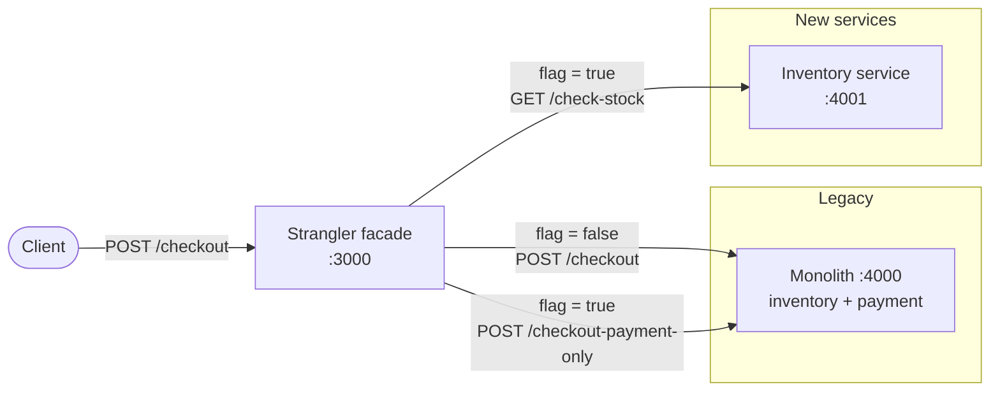

# enterprise-app-modernization

> Incremental migration of a checkout monolith to microservices using the **Strangler Fig** pattern: a routing facade, feature-flag cutover and instant rollback.


---

## Table of contents
- [Overview](#overview)
- [Architecture](#architecture)
- [Key features](#key-features)
- [Tech stack](#tech-stack)
- [Project structure](#project-structure)
- [Getting started](#getting-started)
- [Configuration](#configuration)
- [API reference](#api-reference)
- [Usage](#usage)
- [Operations: rollback runbook](#operations-rollback-runbook)
- [Design decisions](#design-decisions)
- [Roadmap](#roadmap)
- [Documentation](#documentation)
- [Team & author](#team--author)
- [License](#license)

---

## Overview

A monolith keeps every business capability in a single deployable process. As it grows, one failing module can take the others down, scaling a single function means scaling everything, and teams cannot release independently.

Instead of a risky *big-bang* rewrite, this project applies the **Strangler Fig** pattern:

- A **facade** sits in front of the monolith.
- Capabilities are extracted **one at a time** into independent services.
- A **feature flag** decides, per capability, whether traffic goes to the legacy code or to the new service.

The system keeps working throughout the migration, and every step can be reverted by changing a single variable.

**Migration strategy (6 Rs):** *Refactor / Re-architect*.

## Architecture

**Phase 1: inventory extracted** (`STRANGLE_INVENTORY=true`)



| Mode | Inventory check | Payment | `source` in the response |
|---|---|---|---|
| `STRANGLE_INVENTORY=false` (legacy) | Monolith | Monolith | `monolito` |
| `STRANGLE_INVENTORY=true` (modernized) | Inventory service | Monolith | `monolito (solo pago)` / `microservicio-inventario (via fachada)` |

## Key features

- **Single entry point:** clients always call the facade. The `/checkout` contract never changes during the migration.
- **Feature-flag cutover:** routing is controlled by an environment variable, not by a code change.
- **Instant rollback:** set the flag back to `false` and restart only the facade.
- **Independent service:** the inventory service runs, scales and deploys on its own.
- **Transparent error propagation:** downstream HTTP statuses (`409`, `402`) reach the client unchanged.
- **Configurable topology:** service URLs are injected through environment variables, ready for containers or the cloud.

## Tech stack

| Technology | Purpose |
|---|---|
| Node.js 18+ | Runtime for all services |
| Express 5 | HTTP servers (facade, monolith, inventory) |
| Axios | Service-to-service HTTP calls from the facade |
| curl | Manual API testing |

## Project structure

```
enterprise-app-modernization/
├── facade/               # Strangler facade: routes /checkout by feature flag
│   └── app.js
├── monolith/             # Legacy checkout: inventory + payment in one process
│   └── app.js
├── inventory-service/    # Extracted microservice: stock check
│   └── app.js
├── docs/
│   ├── lab-19.md         # Phase 1 record: inventory extraction
│   └── evidence/         # Test screenshots
├── LICENSE
└── README.md
```

## Getting started

### Prerequisites
- Node.js 18 or later
- npm
- curl

### Installation
```bash
git clone https://github.com/JhonnatanPenate/enterprise-app-modernization.git
cd enterprise-app-modernization

cd monolith && npm install && cd ..
cd inventory-service && npm install && cd ..
cd facade && npm install && cd ..
```

### Run
Start each service in its own terminal, from the repository root.

**Windows (cmd)**
```cmd
node monolith/app.js
node inventory-service/app.js

set STRANGLE_INVENTORY=true
node facade/app.js
```

**Windows (PowerShell)**
```powershell
node monolith/app.js
node inventory-service/app.js

$env:STRANGLE_INVENTORY = "true"
node facade/app.js
```

**macOS / Linux**
```bash
node monolith/app.js
node inventory-service/app.js
STRANGLE_INVENTORY=true node facade/app.js
```

The facade prints its active mode on startup:
```
Fachada escuchando en 3000, STRANGLE_INVENTORY=true
```

> ⚠️ In PowerShell, `set VAR=value` does **not** create an environment variable. Use `$env:VAR = "value"`.

## Configuration

| Variable | Service | Default | Description |
|---|---|---|---|
| `STRANGLE_INVENTORY` | facade | `false` | `true` routes the inventory check to the new service |
| `PORT` | facade | `3000` | Facade port |
| `MONOLITH_URL` | facade | `http://localhost:4000` | Monolith base URL |
| `INVENTORY_SERVICE_URL` | facade | `http://localhost:4001` | Inventory service base URL |
| `PORT` | monolith | `4000` | Monolith port |
| `PORT` | inventory-service | `4001` | Inventory service port |

## API reference

### Facade · `:3000`

`POST /checkout`
```json
{ "orderId": "T1", "productId": "sku-1", "amount": 20 }
```

| Status | Body |
|---|---|
| `201` | `{ "success": true, "orderId": "T1", "source": "..." }` |
| `409` | `{ "success": false, "reason": "sin stock", "source": "..." }` |
| `402` | `{ "success": false, "reason": "pago rechazado", "source": "..." }` |
| `500` | `{ "success": false, "reason": "error interno de la fachada" }`, returned when a downstream service is unreachable |

### Monolith · `:4000`

| Method | Endpoint | Body | Description |
|---|---|---|---|
| `POST` | `/checkout` | `orderId`, `productId`, `amount` | Legacy flow: stock, then payment |
| `POST` | `/checkout-payment-only` | `orderId`, `amount` | Payment only, used once inventory is strangled |

### Inventory service · `:4001`

| Method | Endpoint | Response |
|---|---|---|
| `GET` | `/check-stock?productId=sku-1` | `{ "productId": "sku-1", "inStock": true, "source": "microservicio-inventario" }` |

> Stock (~10% failure) and payment (~5% failure) outcomes are simulated with `Math.random()` to exercise the error paths.

## Usage

```bash
curl -X POST http://localhost:3000/checkout \
  -H "Content-Type: application/json" \
  -d '{"orderId":"T1","productId":"sku-1","amount":20}'
```

**Legacy mode** (`STRANGLE_INVENTORY=false`)
```json
{"success":true,"orderId":"T2","source":"monolito"}
```

**Modernized mode** (`STRANGLE_INVENTORY=true`)
```json
{"success":true,"orderId":"S2","source":"monolito (solo pago)"}
{"success":false,"reason":"sin stock","source":"microservicio-inventario (via fachada)"}
```

Screenshots of both modes are in [`docs/evidence/`](docs/evidence/).

## Operations: rollback runbook

**Symptom:** errors or latency in the inventory service after the cutover.

1. Stop the facade (`Ctrl+C`).
2. Set `STRANGLE_INVENTORY=false`.
3. Start the facade again and confirm the startup log shows `STRANGLE_INVENTORY=false`.
4. Send a test `POST /checkout` and confirm `"source":"monolito"`.

**Why it is fast:** the monolith was never modified or shut down, so no code is reverted, rebuilt or redeployed. Clients are unaffected because the API contract is the same. The rollback takes seconds, compared with rebuilding, testing and republishing a full release.

## Design decisions

| Decision | Rationale |
|---|---|
| Strangler Fig instead of a big-bang rewrite | Small, reversible steps; the system stays available during the migration |
| Inventory extracted first | Pure function with no dependencies on other domains, so it is the lowest-risk first cut |
| Routing via a feature flag | Cutover and rollback become configuration changes, not deployments |
| `/checkout-payment-only` added to the monolith in advance | No further change to legacy code is needed when inventory is strangled |
| Service URLs as environment variables | The same code runs locally, in containers or in the cloud |

## Roadmap

- [x] **Phase 1 (Lab 19):** build the monolith, extract the inventory service, add the facade with a feature flag
- [ ] **Phase 2 (Lab 20):** extract payment, retire the monolith completely, integrate with cloud services

## Documentation

- [Lab 19: inventory extraction](docs/lab-19.md)
- Related: [cloud-devsecops-labs](https://github.com/JhonnatanPenate/cloud-devsecops-labs), Labs 1–18 (DevSecOps, IaC, event-driven, Kubernetes, FinOps)

## Team & author

Built for **Cloud Development II**, ESEN (El Salvador), 2026.

**Team:** Susana Beltrán · Debbie Cruz · Andre Iraheta · Tiffany Meléndez · Dana Ochoa · Jhonnatan Peñate

**Maintainer:** Jhonnatan Peñate Serrano · [GitHub](https://github.com/JhonnatanPenate) · [LinkedIn](https://www.linkedin.com/in/jhonnatan-penate)

## License

Distributed under the MIT License. See [`LICENSE`](LICENSE).
