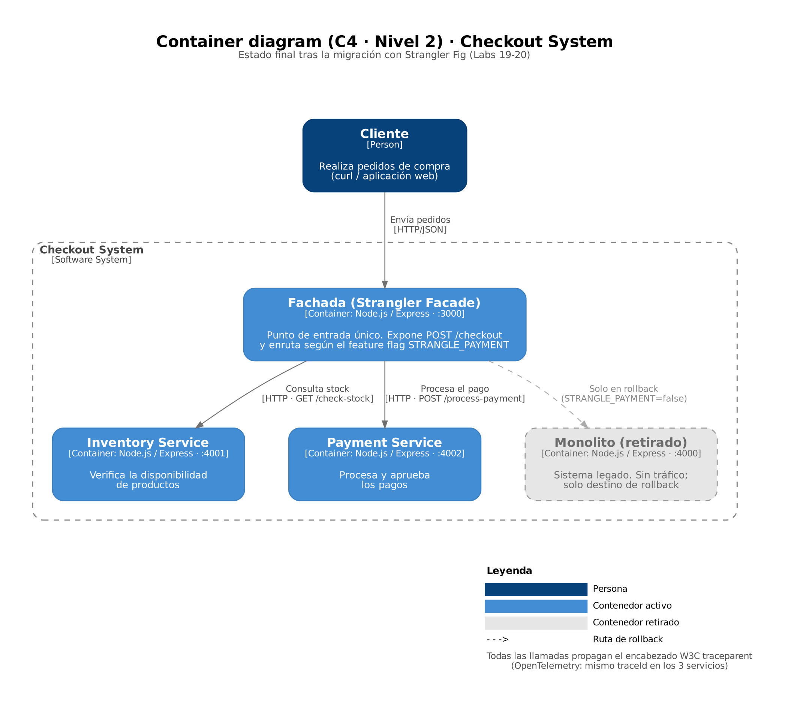

# Production Readiness Plan

How the final architecture would be taken to production using the techniques built in [cloud-devsecops-labs](https://github.com/JhonnatanPenate/cloud-devsecops-labs) (Labs 1–18). This is a design document, not an implementation.

← Back to the [README](../README.md)

## 1. Architecture

The client calls only the facade (`POST /checkout`). The facade asks the inventory service for stock and, if stock is available, charges through the payment service, all over HTTP. The monolith is retired and only receives traffic if `STRANGLE_PAYMENT=false` (rollback). OpenTelemetry propagates one `traceId` across the three processes through the W3C `traceparent` header.

## 2. Security (Labs 1–4)
| Job | Applied to | Purpose |
|---|---|---|
| CodeQL | Every service | Static analysis of the JavaScript code |
| Gitleaks | Every service | Secret detection on each commit (proven to block the pipeline in Lab 4) |
| Trivy + SBOM | Every service and container image | Dependency and image vulnerabilities, software bill of materials |
| SonarQube | Every service | Quality gate and coverage |

**Pipeline model:** one shared, reusable GitHub Actions workflow, executed **independently per service** through path filters. Security rules stay uniform while each team ships its own service.

## 3. Infrastructure (Labs 5–6)
A reusable Terraform module, `microservice`, takes the name, image, port, CPU and memory, replica count, environment variables and tags as inputs. It creates the image repository, a least-privilege IAM role, the log group, the alarms and the SNS topic, and is instantiated three times (inventory, payment, facade).

| Setting | dev | prod |
|---|---|---|
| Replicas / instance size | Minimal | Higher |
| Autoscaling limits | Low | Higher |
| Log retention | Short | Long |
| Alarm thresholds | Relaxed | Strict |
| Deletion protection | Off | On |

Each environment keeps its own remote state in S3 with DynamoDB locking.

## 4. Observability (Labs 7–8)
- **Every service:** request count, 4xx/5xx error rate, p95/p99 latency, availability.
- **Business metrics:** out-of-stock rate (inventory, `409`), payment rejection rate (payment, `402`), downstream failures (facade, `500`).
- **Payment alarm:** the normal rejection rate is about 5%. Alarm when payment errors exceed **10% for 5 consecutive minutes**, or on any `5xx`, and notify the owning team through SNS. The alert also supports a quick rollback decision.
- **Tracing:** replace the console exporter with an OTLP exporter to a tracing backend (for example, AWS X-Ray).

## 5. Packaging & deployment (Labs 13–16)
- **Containers:** multi-stage Dockerfile per service (`node` alpine base, `npm ci --omit=dev`, non-root user, single exposed port) and a `/health` endpoint for liveness and readiness probes.
- **Helm:** one generic `microservice` chart and one release per service, with `values-dev.yaml` and `values-prod.yaml`.

| | dev | prod |
|---|---|---|
| Replicas | 1 | 3 |
| HPA | Off | Min 3, max 10, 70% CPU |
| PodDisruptionBudget | Off | `minAvailable: 2` |
| Ingress | Facade only | Facade only |

Inventory and payment are internal `ClusterIP` services; the facade reaches them through Kubernetes DNS (for example `http://inventory-service:4001`) via the same environment variables it already uses.

## 6. Cost allocation (Labs 17–18)
| Tag | Example |
|---|---|
| `CostCenter` | `checkout` |
| `Environment` | `dev` / `prod` |
| `Service` | `inventory` / `payment` / `facade` |
| `Owner` | Owning team |
| `Project` | `enterprise-app-modernization` |
| `ManagedBy` | `terraform` |

Tags are applied through Terraform `default_tags` and activated as cost-allocation tags in Billing. The scheduled tag-compliance Lambda from Lab 18 would be extended to check `Service` and `Owner` as well.

## 7. Key takeaways
1. **Strangler Fig with feature flags:** a real system can be modernized without downtime; each step is small, testable in production and reversible in seconds.
2. **Observability and distributed tracing:** without metrics, alarms and traces there is no way to prove the new piece works better, or that the monolith no longer receives traffic. A shared `traceId` across three processes made that verifiable.
