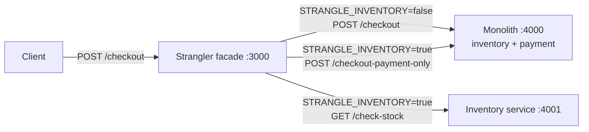
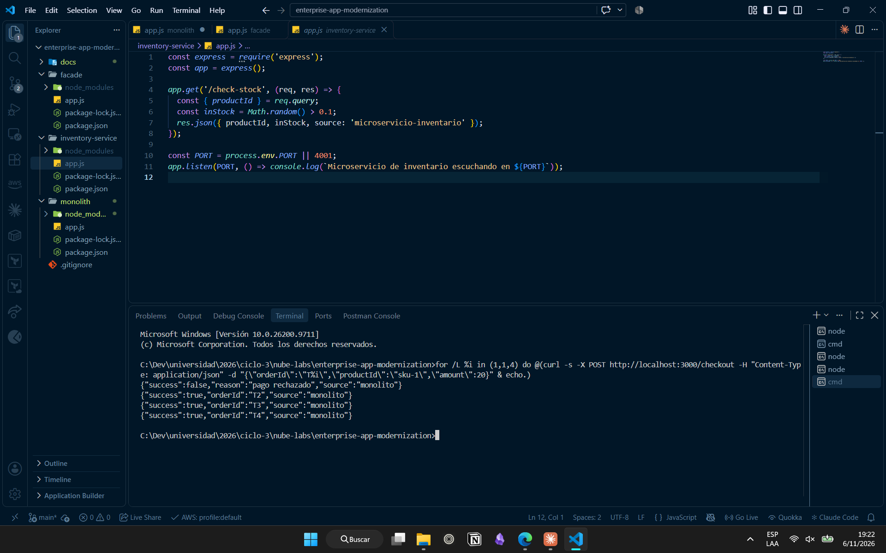
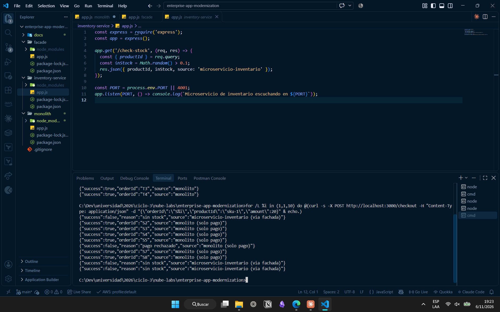
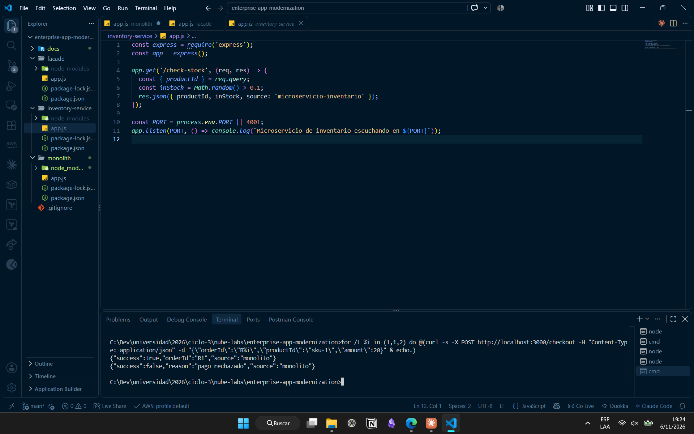
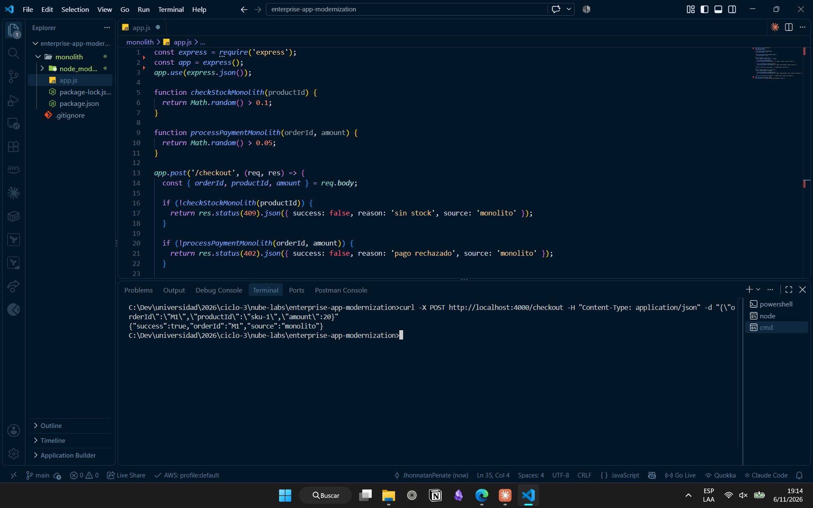
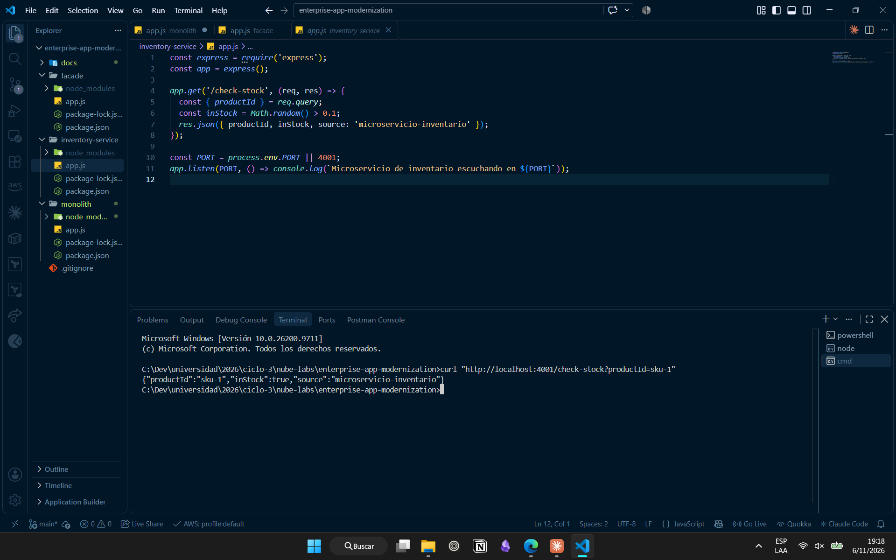

# Lab 19 · Monolith Modernization with the Strangler Fig Pattern

**Tag:** `lab-19` · **Week:** 10 · **Area:** Application modernization · **Cost:** $0 (runs locally)

## Goal
Build a checkout monolith that holds all business logic in one process, then extract its first piece (the inventory check) into an independent microservice. A facade decides, through a configuration flag, whether each request is served by the monolith or by the new service.

## Architecture



## Services & tools
| Component | Port | Role |
|---|---|---|
| `monolith/` | 4000 | Original app: inventory and payment in a single process. Also exposes `/checkout-payment-only` for the strangled route. |
| `inventory-service/` | 4001 | Extracted microservice: `GET /check-stock` |
| `facade/` | 3000 | Single entry point. Routes by `STRANGLE_INVENTORY`, so the `/checkout` API contract never changes. |
| Node.js + Express, axios | — | Runtime, HTTP servers and service-to-service calls |

## What was built
- `monolith/app.js`: `POST /checkout` (stock, then payment) and `POST /checkout-payment-only`.
- `inventory-service/app.js`: stateless stock check, the first candidate to extract because it is a pure function with no dependencies on other business areas.
- `facade/app.js`: the feature flag `STRANGLE_INVENTORY`, plus service URLs configurable through `INVENTORY_SERVICE_URL` and `MONOLITH_URL`. Downstream HTTP errors (409 / 402) are passed through unchanged.

## How to run
One terminal per process (Windows `cmd`):
```cmd
node monolith/app.js
node inventory-service/app.js

set STRANGLE_INVENTORY=true
set PORT=3000
node facade/app.js
```
Client:
```cmd
curl -X POST http://localhost:3000/checkout -H "Content-Type: application/json" -d "{\"orderId\":\"T1\",\"productId\":\"sku-1\",\"amount\":20}"
```
Run `npm install` inside each service folder first.

## Technical decisions
- **Strangler Fig instead of a big-bang rewrite:** each step is small and reversible, and the system keeps working throughout the migration.
- **Feature flag in the facade:** routing changes without touching the monolith or the new service.
- **`/checkout-payment-only` prepared in advance:** the monolith does not need another change when inventory is extracted.
- **Same response contract:** callers of `/checkout` do not know which backend answered.

## Results

**Before (`STRANGLE_INVENTORY=false`):** every request is resolved by the monolith.



**Modernized (`STRANGLE_INVENTORY=true`):** stock comes from the microservice and payment from the monolith. Out-of-stock rejections now come from the new service.



**Rollback:** setting the flag back to `false` and restarting only the facade returns all traffic to the monolith.



Individual services:




> Some responses show `pago rechazado` or `sin stock`. This is expected: both checks are simulated with `Math.random()` (~5% and ~10% failure rate).

## Rollback in a real incident
If the inventory microservice failed in production, it would be enough to set `STRANGLE_INVENTORY=false` and restart only the facade. All `/checkout` traffic would go back to the monolith, which was never modified or shut down. Nothing has to be reverted, rebuilt or redeployed, and clients notice nothing because the API contract is the same. A rollback therefore takes seconds, while reverting a full deployment means rebuilding, testing and republishing the whole application, with more risk and downtime.

## Lessons learned
- The lab instructions use `cmd` syntax. In PowerShell, `set` does not create an environment variable, so the facade silently stays in `false` mode: use `cmd`, or `$env:STRANGLE_INVENTORY="true"` in PowerShell.
- `error interno de la fachada` (HTTP 500) means a downstream service is not running (ECONNREFUSED). All three processes must be up at the same time.

## Next
Lab 20 completes the migration: payment is extracted as well, and the monolith is retired.
