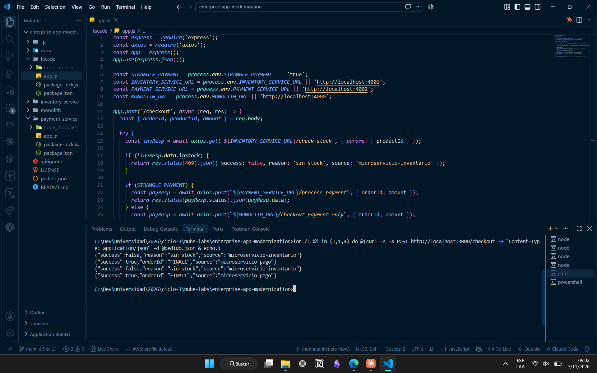
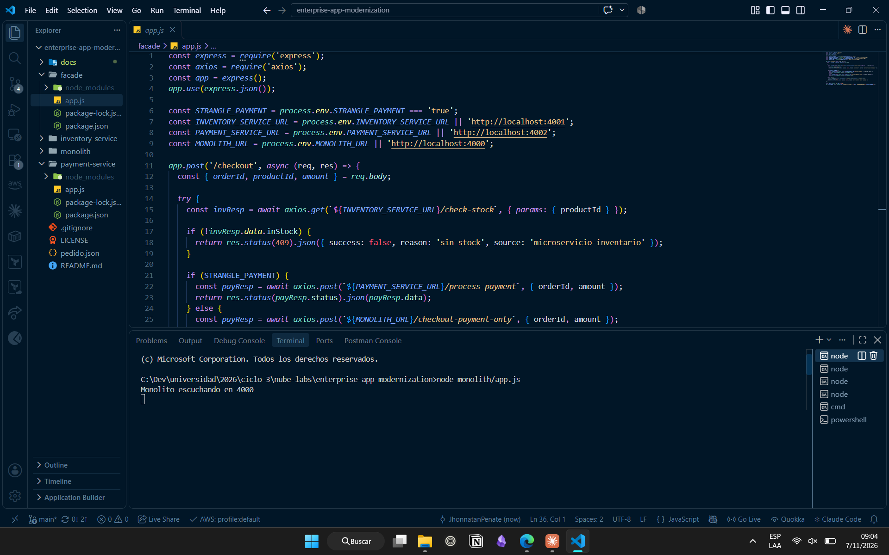
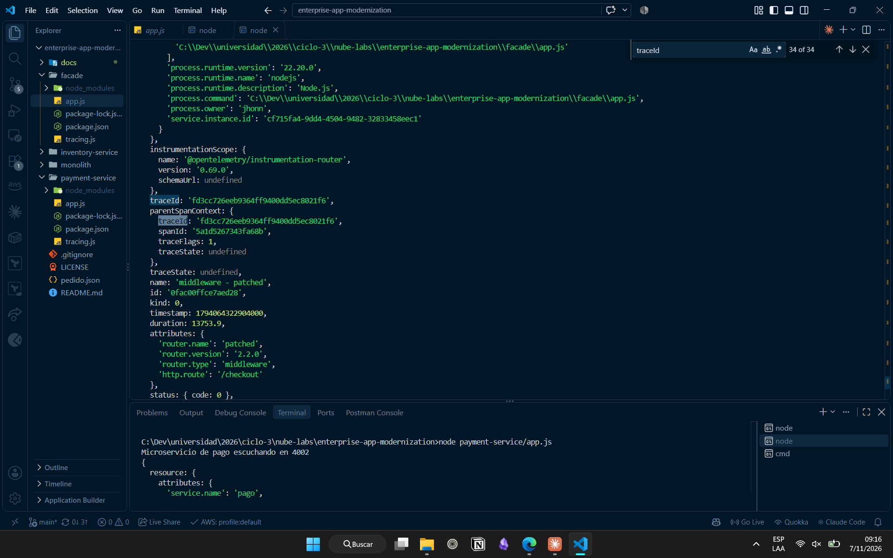
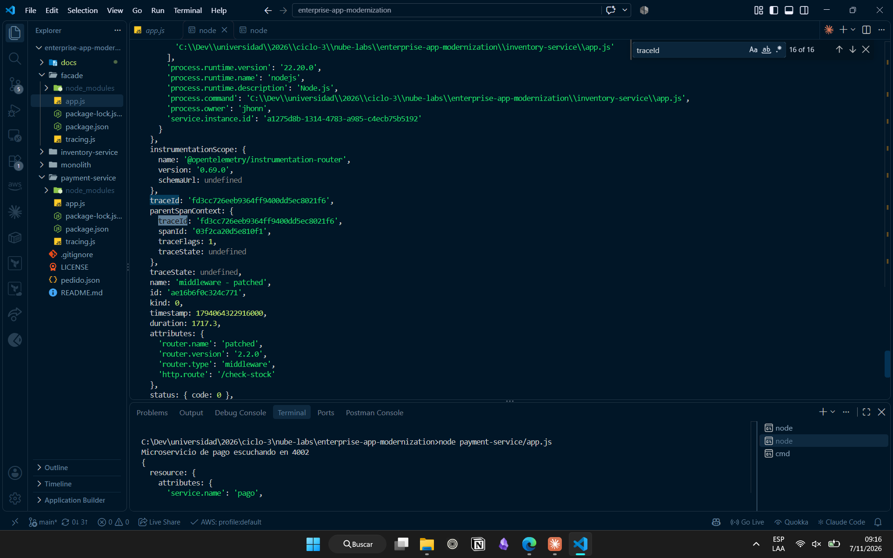
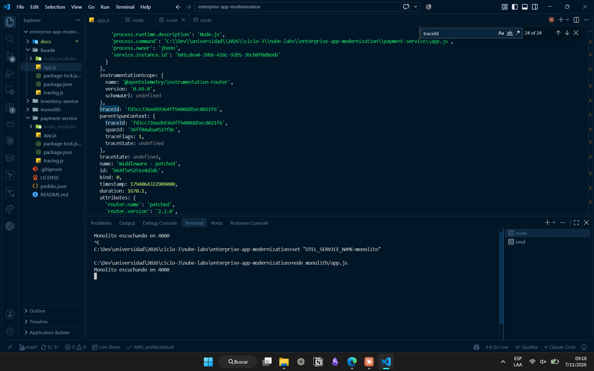
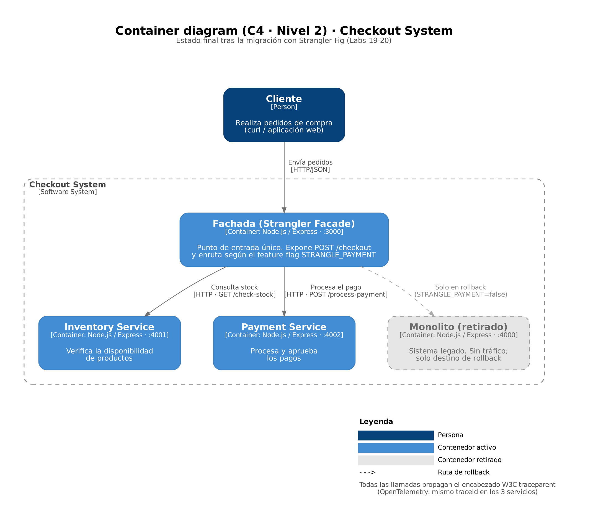

# Lab 20 · Payment Extraction, Monolith Retirement and Distributed Tracing

| | |
|---|---|
| **Tag** | `lab-20` |
| **Course** | Cloud Development II · ESEN · Week 10 (Application modernization) · integrative project |
| **Phase** | 2 of 2 (continues [Lab 19](lab-19.md)) |
| **Environment** | Local, Node.js only · cost $0 |
| **Date** | 2026-11-07 |

← Back to the [README](../README.md) for the architecture, setup and API reference.

## Goal
Complete the migration started in Lab 19: extract payment into its own service, retire the monolith completely, and add real distributed tracing across the independent services.

## What changed in this phase
| Component | Change |
|---|---|
| `payment-service/` | New. `POST /process-payment` on port 4002 |
| `facade/app.js` | Final version. Inventory is always served by the inventory service; payment is routed by `STRANGLE_PAYMENT` |
| `*/tracing.js` | New in all four services. OpenTelemetry Node SDK with HTTP/Express auto-instrumentation and a console exporter |
| `*/app.js` | `require('./tracing')` added as the first line |
| `pedido.json` | Sample order for the tests |

## Test results

| # | Scenario | Expected | Result | Evidence |
|---|---|---|---|---|
| 1 | All services start | Each one logs its port | ✅ | [monolith](evidence/lab-20-a-monolito-inicio.png) · [inventory](evidence/lab-20-a-inventario.png) · [payment](evidence/lab-20-a-pago.png) |
| 2 | Payment strangled, 4 requests | `source: microservicio-pago` | ✅ | [b-strangle-payment-true](evidence/lab-20-b-strangle-payment-true.png) |
| 3 | Monolith after those requests | Only the startup line: zero activity | ✅ | [b-monolito-sin-actividad](evidence/lab-20-b-monolito-sin-actividad.png) |
| 4 | Single traced request | `source: microservicio-pago` | ✅ | [c-curl-pedido](evidence/lab-20-c-curl-pedido.png) |
| 5 | Trace propagation | Same `traceId` in facade, inventory and payment | ✅ `fd3cc726eeb9364ff9400dd5ec8021f6` | [facade](evidence/lab-20-c-trace-fachada.png) · [inventory](evidence/lab-20-c-trace-inventario.png) · [payment](evidence/lab-20-c-trace-pago.png) |
| 6 | Instrumented monolith | No spans printed | ✅ | [c-trace-pago](evidence/lab-20-c-trace-pago.png) (lower panel) |

### Payment served by the new service

### Monolith with zero activity

### Same traceId across three processes

## Final architecture

The production plan built on Labs 1–18 (security pipeline, Terraform, CloudWatch alarms, Helm, cost tags) is in [`architecture.md`](architecture.md).

## Issues & lessons learned
| Issue | Cause | Fix |
|---|---|---|
| Facade started with `STRANGLE_PAYMENT=false` | A trailing space after `set STRANGLE_PAYMENT=true` in cmd became part of the value (`"true "`) | Quote the assignment: `set "STRANGLE_PAYMENT=true"` |
| `npm ERESOLVE` installing OpenTelemetry | Latest `auto-instrumentations-node` needs `@opentelemetry/api` ≥ 1.10, latest `sdk-trace-node` declares < 1.10 | `npm install --legacy-peer-deps` (the 1.x API is backward compatible) |
| A folder named `-p` appeared | `mkdir -p` is a Unix option; Windows `cmd` treats it as a folder name | Use `mkdir payment-service` on Windows; the extra folder was removed |
| `-d @pedido.json` failed in PowerShell | `@` is the splatting operator in PowerShell | Quote it (`-d "@pedido.json"`) and use `curl.exe` |
| Hard to compare traces across terminals | Each service prints to its own terminal | Moved the terminals into the VS Code editor area, side by side, and searched for `traceId` |

## Result
The monolith receives no traffic; the system runs as three independent services behind the facade, and a single `traceId` follows each request across process boundaries.
